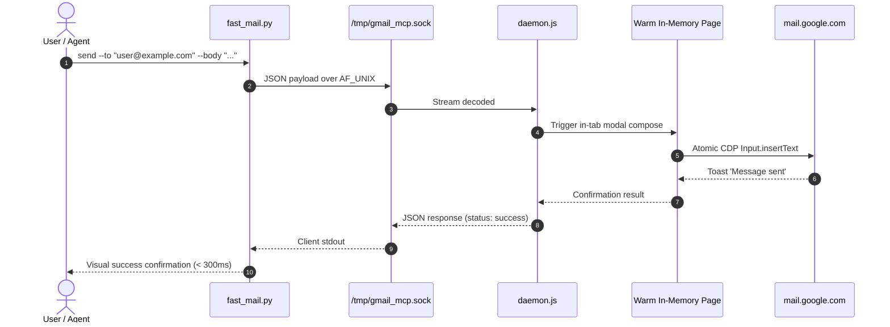

# Architecture & System Design: Gmail Browser MCP

## Overview

The `gmail-browser-mcp` server provides high-performance, browser-automated Model Context Protocol (MCP) integration with Gmail. It bridges AI assistants and LLMs to real-world Gmail operations with sub-second execution, stealth automation, and persistent session management.

```mermaid
flowchart TD
    A[AI Assistant / Client] -->|MCP Stdio / JSON-RPC| B[MCP Server Router]
    A -->|Unix Domain Socket| C[Python Fast Client CLI]
    C -->|/tmp/gmail_mcp.sock| D[Persistent Background Daemon]
    B --> E[BrowserSessionManager]
    D --> E
    E -->|CDP / Playwright| F[Persistent Chrome Profile]
    F -->|Zero Cookie Exports| G[Google Gmail Webmail]
    subgraph Security Layer
        H[Circuit Breakers & Challenge Detector]
        I[RFC 5322 Email Validator]
        J[Rate Limiter & Typing Pacing]
        K[Prompt Injection Sanitizer]
    end
    E --- Security Layer
```

---

## 1. Persistent Profile Architecture (Option B)

Unlike ephemeral browser contexts that require exporting fragile JSON session cookies (`__Secure-1PSIDTS`, `OSID`) every 12–24 hours, Option B maintains a dedicated persistent Chrome profile directory:

```
~/.gmail-mcp-profile/
├── Default/
│   ├── Cookies
│   ├── Local Storage/
│   └── Network/
└── Local State
```

- **Persistence**: Playwright connects via `chromium.launchPersistentContext(profileDir)`.
- **Zero Token Rotation**: Google's session cookies renew automatically inside Chrome's native storage.
- **Stealth**: Launched with `--disable-blink-features=AutomationControlled` and clean navigator properties.

---

## 2. Unix Domain Socket Daemon (`/tmp/gmail_mcp.sock`)

For instant execution without cold browser boot times:



---

## 3. High-Speed Input Injection Pipeline

1. **CDP Direct Insertion**: Text is injected into Gmail's contenteditable message body via Chrome DevTools Protocol (`Input.insertText`) rather than character-by-character typing.
2. **Pacing Queue**: High-frequency commands are serialized through an adaptive rate-limiter to prevent anti-abuse detection.
3. **Hydration Guard**: Dynamic locators inspect Gmail's `div[gh='cm']` and action toasts for deterministic confirmation.
